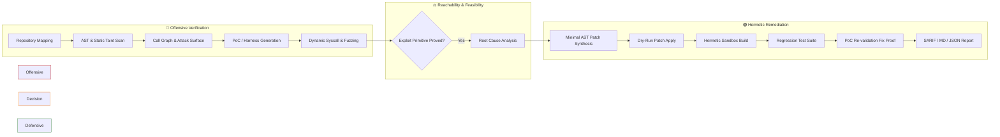

# 🛡️ VTX-CRS: Autonomous Cyber Reasoning System

[](https://www.python.org/)
[](LICENSE)
[](https://github.com/OEvortex/vtx-crs)
[](https://github.com/OEvortex/vtx-crs)
[](tests)

> **Autonomous AI Software Security Engineer** uniting offensive vulnerability research & binary exploitation with AST-level defensive remediation, hermetic validation, regression testing, and cryptographic audit reporting.

---

## ⚡ Overview

**VTX-CRS** is not a chatbot — it is a Tier-0 **Cyber Reasoning System (CRS)** modeled after DARPA AIxCC and DrDio capabilities. Built on the extensible `vtx-coding-agent` runtime, it operates autonomously on unknown, closed, or open-source repositories to discover, prove, exploit, and remediate critical security vulnerabilities without human bottlenecks.

### The Dual-Wing Doctrine

VTX-CRS adheres strictly to the **Mandatory Dual-Wing Execution** principle: *Offense and Defense are inseparable.*



1. **No Evidence = No Vulnerability**: Pattern hits are merely hypotheses. Proof requires untrusted source to unguarded sink mapping (`file:line`), call reachability verification, and reproducible trigger vectors.
2. **Exploit Feasibility Classification**: Audits against platform mitigations (`NX`, `PIE`, `RELRO`, `Stack Canary`, `FORTIFY`, `ASLR`).
3. **Minimal Blast-Radius Patching**: Fixes root causes (parameterized queries, `realpath` boundary checks, safe deserialization) without cosmetic churn.
4. **Hermetic Regression Loop**: Patches must pass build compilation, zero test regressions, and PoC re-test execution before certification.

---

## ✨ Core Capabilities

### 🔍 Deep Analysis & Discovery
- **Codebase Mapping (`repo_analyze`)**: Identifies languages, package managers, build configs, entry points, and test harnesses.
- **Unified Security Scanner (`unified_scan` / `vuln_scan`)**: High-throughput CWE pattern matching (SQLi, SSRF, Command Injection, XSS, Path Traversal, Deserialization, Hardcoded Secrets).
- **Keyless Dependency Auditing (`dependency_scan`)**: Direct integration with the Open Source Vulnerabilities (OSV) API for zero-config CVE/GHSA lookups.
- **AST Taint & Call Graph Tracing (`taint_analyzer`, `call_graph`)**: Inter-procedural data flow tracking from external inputs to dangerous sinks.
- **Attack Surface Analysis (`attack_surface`, `service_analyzer`, `web_scanner`)**: Route mapping, network surface probing, privilege boundaries, and RPC entry discovery.

### 💥 Offensive Verification
- **Dynamic Tracing & Crash Triage (`dynamic_analyzer`, `crash_triager`)**: Dynamic execution inspection, core dump triage, ASan/UBSan report parsing, and register state extraction.
- **Automated Fuzz Harnesses (`harness_generator`, `fuzz_harness`)**: Synthesizes libFuzzer/AFL/AFL++ harnesses and Python fuzz drivers.
- **PoC & Exploit Feasibility (`pov_generator`, `exploit_feasibility`)**: Builds Proof-of-Vulnerability (PoV) triggers and evaluates exploitation constraints.
- **Offensive Chain Tool (`offensive_chain`)**: Coordinates end-to-end vulnerability reproduction pipelines.

### 🛡️ Defensive Remediation & Validation
- **Unified Diff Engine (`patch_apply`)**: Validates, dry-runs, and applies surgical unified diffs with automatic hunk fuzz tolerance and rollback safety.
- **Hermetic Sandbox Validation (`patch_validator`)**: Builds and runs regressions in isolated containers to guarantee no functional breakage.
- **Build & Test Automation (`build_runner`, `test_runner`)**: Multi-ecosystem detection and execution across `cargo`, `go`, `pytest`, `npm`, `make`, `cmake`, and `maven`.
- **Audit Case Management (`case_manager`, `report_generator`)**: Maintains an append-only cryptographic finding ledger, exporting Markdown, JSON, and SARIF artifacts.

---

## 🛠️ Specialized Tool Matrix

VTX-CRS injects a custom suite of 20+ specialized security tools into the agent reasoning loop:

| Tool | Category | Operational Purpose |
|------|----------|---------------------|
| `unified_scan` | Discovery | High-performance batch scan combining SAST, secrets, and taint heuristics |
| `repo_analyze` | Discovery | Maps project structure, languages, build files, and test frameworks |
| `vuln_scan` / `sast_scanner` | Discovery | CWE-targeted static source analysis across all major programming languages |
| `dependency_scan` | Discovery | Keyless CVE/GHSA dependency matching via the OSV database |
| `taint_analyzer` | Discovery | Inter-procedural taint flow analysis from untrusted sources to sinks |
| `call_graph` | Discovery | Synthesizes inter-function call graphs and reachability paths |
| `attack_surface` | Discovery | Maps routes, RPCs, public endpoints, and privilege boundaries |
| `web_scanner` | Discovery | Probes web applications for misconfigurations and common OWASP Top 10 |
| `service_analyzer` | Discovery | Inspects system services, daemon configs, and network listeners |
| `binary_analyzer` | Offensive | Checks binary protections (RELRO, Canary, NX, PIE) and symbol tables |
| `dynamic_analyzer` | Offensive | Executes binaries under trace inspection and system call instrumentation |
| `crash_triager` | Offensive | Analyzes crashes, core dumps, ASan traces, and faulting instructions |
| `harness_generator` | Offensive | Automatically constructs fuzz targets and driver code |
| `fuzz_harness` | Offensive | Executes targeted fuzzing jobs to discover memory or logic faults |
| `pov_generator` | Offensive | Generates deterministic Proof-of-Vulnerability reproducer scripts |
| `exploit_feasibility` | Offensive | Assesses weaponization potential against modern mitigations |
| `offensive_chain` | Offensive | High-velocity end-to-end offense orchestrator |
| `patch_apply` | Defensive | Validates and applies surgical, minimal unified diffs |
| `patch_validator` | Defensive | Hermetic validation checking build, tests, and PoC mitigation |
| `build_runner` | Defensive | Auto-detects and triggers project-native build systems |
| `test_runner` | Defensive | Executes regression test suites and computes pass/fail metrics |
| `coverage_analyzer` | Defensive | Evaluates code coverage deltas for patches and tests |
| `mitigation_injector` | Defensive | Hardens code with defensive guards, wrappers, and safe parsers |
| `case_manager` | Audit | Tracks findings, patches, and proof states across security cases |
| `report_generator` | Audit | Compiles structured executive and technical reports (Markdown & JSON) |

---

## 🚀 Getting Started

### Prerequisites

- **Python**: `>= 3.12`
- **Package Manager**: [`uv`](https://docs.astral.sh/uv/) (recommended) or `pip`
- **Compiler / Test Toolchains**: Appropriate compilers (`gcc`, `clang`, `cargo`, `go`, etc.) installed if running local build and fuzz tools.

### Installation

Clone the repository and install in editable mode:

```bash
git clone https://github.com/OEvortex/vtx-crs.git
cd vtx-crs

# Using uv (Recommended)
uv sync --all-groups
uv pip install -e .

# Or using standard pip
python3 -m pip install -e .
```

---

## 💻 CLI Usage

VTX-CRS supports both interactive terminal interfaces (TUI) and headless automated pipelines:

### 1. Headless Full Pipeline
Direct the agent to run an autonomous end-to-end security engagement on any repository:

```bash
vtx-crs --repo /path/to/target \
  -p "Perform a complete security audit, reproduce any findings with PoCs, apply minimal patches, verify via tests, and generate a final report."
```

### 2. Interactive Terminal UI
Launch the rich interactive Textual TUI directly in the target repository:

```bash
# Target specific repository
vtx-crs --repo /path/to/target

# Or run directly inside the current working directory
cd /path/to/target
vtx-crs
```

### 3. Provider & Model Selection
VTX-CRS supports any OpenAI-compatible, Anthropic, or local model endpoint:

```bash
# Using Anthropic Claude 3.7 Sonnet
vtx-crs -m claude-3-7-sonnet-20250219 --provider anthropic

# Using OpenAI or local OpenAI-compatible endpoints (Ollama, vLLM, LMStudio)
vtx-crs -m qwen2.5-coder -u http://localhost:11434/v1 --provider openai
```

### 4. Resuming Engagements
Session persistence allows you to resume prior investigations seamlessly:

```bash
# Resume the most recent session
vtx-crs -c

# Resume a specific session by ID
vtx-crs -r 754974b2-a4ce-4a7b
```

---

## 🧪 Testing & Verification

The suite includes tests for patch application, diff generation, vulnerability scanners, and UI branding:

```bash
# Run full pytest suite with uv
uv run pytest

# Run ruff code formatting and linter
uv run ruff check .
```

---

## 🔒 Security & Safe Operation

- **Target Data Quarantine**: Target code, SARIF inputs, strings, and decompilation are isolated strictly as untrusted *data*, preventing prompt injection and instructions embedded in scanned code from hijacking agent directives.
- **Safe Sandboxing**: Dynamic analysis and fuzz tools should ideally run within isolated containers or unprivileged sandbox environments when auditing untrusted binaries.

---

## 📄 License

VTX-CRS is released under the **GNU Affero General Public License v3.0 (AGPL-3.0)**. See [LICENSE](LICENSE) for full details.
